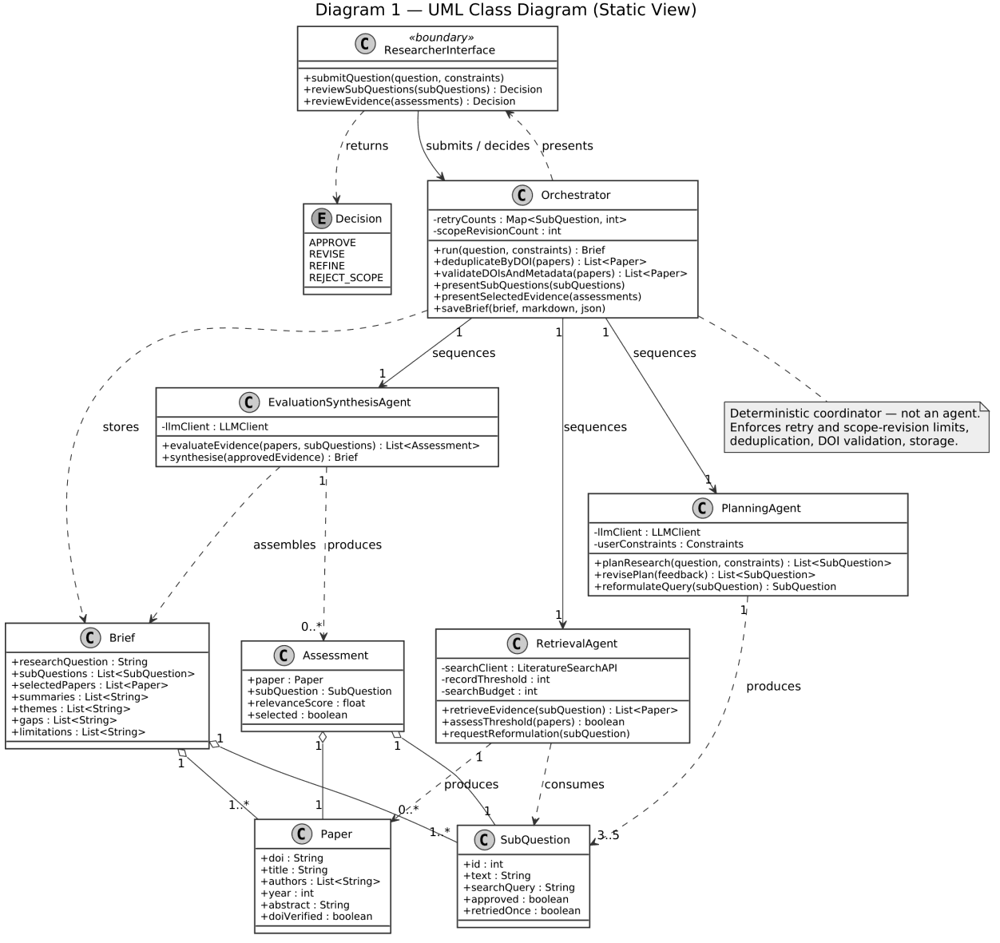
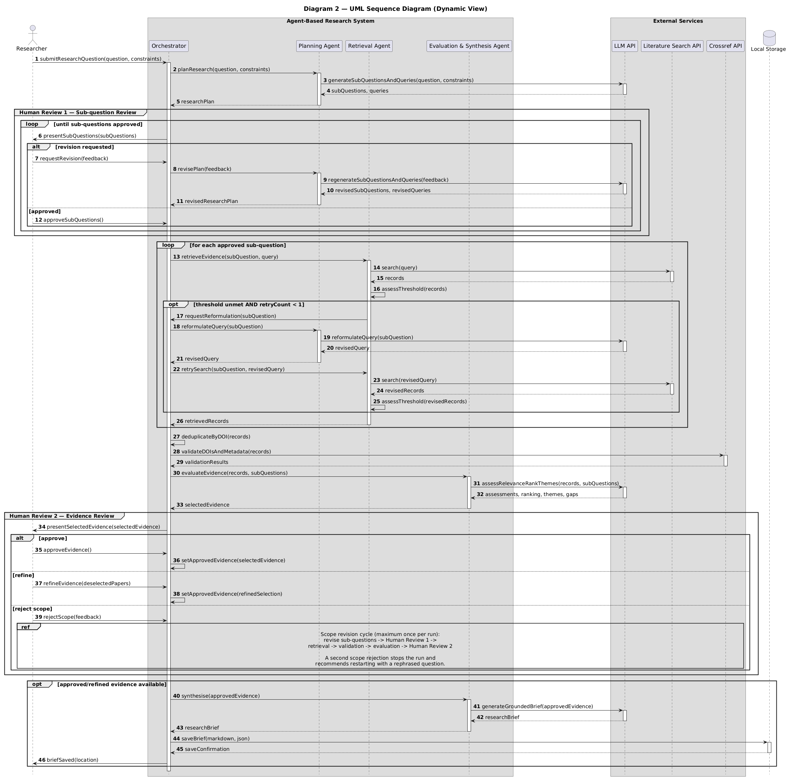
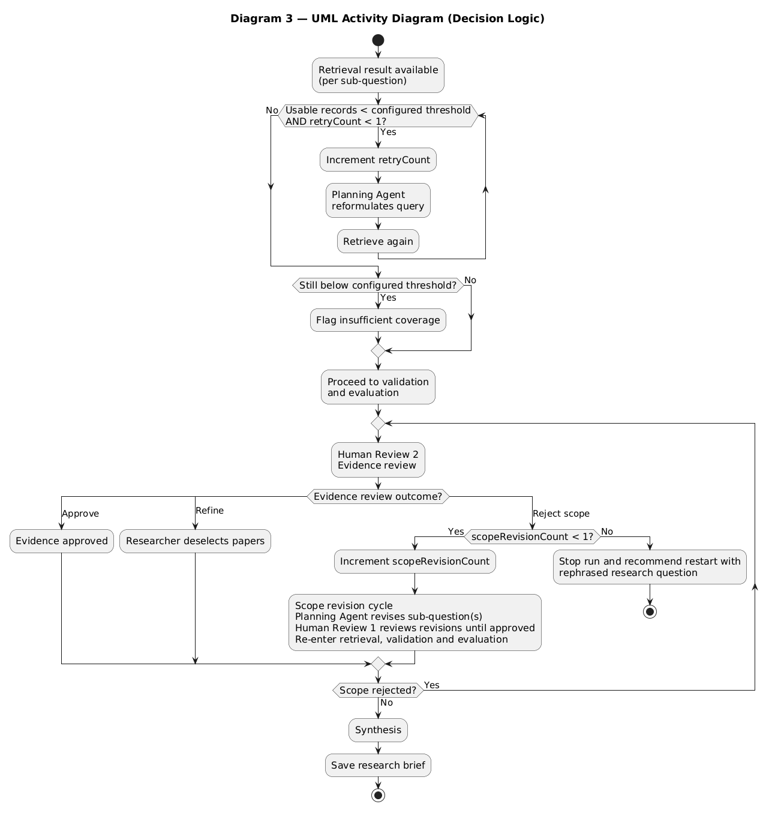

# Week 7 - Final Project Design Phase: Project Report, Group D

**Team members:** Lana Menezes Fidelis, Lara Koller, Sergei Misjura, Dragos Hont
**Submission date:** 7 September 2026

## 1. System Overview, Purpose and Scope

Academic literature searching is time-consuming and error-prone when performed manually (van de Schoot et al., 2021). This project proposes an agent-based system automating key stages of that process. The user submits a high-level research question; three coordinated agents plan the search, retrieve scholarly literature, evaluate the evidence, and generate a research brief saved as Markdown and JSON, containing selected papers with DOIs, summaries, themes, gaps and the search's stated limitations. Intended users are students and researchers beginning a search, not seeking a finished paper. The system assumes a well-formed English question and sufficient relevance signal from abstracts. Scope is deliberately bounded: abstract-level data, one search source, local output, and limited refinement, favouring controllable, auditable behaviour over broader but unpredictable capability.

## 2. Proposed Architecture and Agent Roles

The system comprises three specialised agents, each satisfying properties of autonomy, reactivity and pro-activeness associated with agency (Wooldridge and Jennings, 1995). The Planning Agent decomposes the research question into sub-questions and search queries. The Retrieval Agent queries the Semantic Scholar API and judges whether it met a predefined record threshold. The Evaluation and Synthesis Agent scores relevance, filters results and produces the final brief. Dividing responsibility by role, rather than one general-purpose agent, isolates failures and lets retrieval outcomes be judged independently of planning (Hong et al., 2024). A deterministic orchestrator, not itself an agent, sequences these agents, deduplicates records, validates DOIs against Crossref, and writes the brief to local Markdown and JSON files.

Two human-review points bound this exchange: after decomposition, and after evidence selection. Between them, the Retrieval Agent can request via the orchestrator that the Planning Agent reformulate a query when its threshold is unmet, the system's only automatic replanning path in the original design.

**Diagram 1 (UML Class Diagram):** `ResearcherInterface` submits a question and decisions (APPROVE / REVISE / REFINE / REJECT_SCOPE) to the `Orchestrator`, which sequences the `PlanningAgent`, `RetrievalAgent` and `EvaluationSynthesisAgent`, enforces `retryCounts` and `scopeRevisionCount` limits, and assembles the `Brief` from `Assessment`, `Paper` and `SubQuestion` objects. The orchestrator is explicitly annotated as "Deterministic coordinator, not an agent."

## 3. System Requirements

- A general-purpose LLM, accessed via a free-tier hosted API (e.g. Google Gemini Flash), supports the Planning Agent's decomposition and query generation and the Evaluation and Synthesis Agent's relevance scoring and summarisation.
- The Semantic Scholar API is the primary literature source, chosen for strong abstract coverage; OpenAlex serves as fallback if access is unavailable.
- The Crossref API independently verifies each retrieved DOI and its metadata.
- Python 3.11+, with requests and Pydantic, implements agent logic and validates LLM output; python-dotenv manages secrets.
- Markdown and JSON store the traceable brief locally; Python logging records queries, relevance scores and decisions for post-run inspection.
- VS Code, venv and GitHub form the development environment; pytest covers parsing, validation and deduplication.

## 4. Design Decisions and Technical Rationale

The proposed system separates planning, retrieval and evaluation/synthesis into specialised agents, coordinated by a deterministic orchestrator. Additional coordination is not assumed to improve performance: Kim et al. (2026) find multi-agent gains are task- and architecture-dependent and show that architectures without centralised verification propagate errors more strongly. The design therefore limits coordination to three agents and routes interactions through the orchestrator, providing a central control point for deterministic checks and workflow rules, prioritising traceable execution over emergent coordination.

Because LLMs can generate unsupported outputs (Klesel and Wittmann, 2025), model use is restricted to semantic tasks: question decomposition, relevance assessment and synthesis. Threshold checks, DOI/metadata validation, deduplication and storage remain deterministic, trading flexibility for predictable behaviour where exact rules suffice. Evaluation and synthesis remain one agent because synthesis consumes the evaluation output, avoiding another handoff while retaining human approval between phases. Retrieved scholarly evidence grounds synthesis; Klesel and Wittmann (2025) report that RAG can reduce hallucinations, improve factual accuracy and provide source references.

Finally, autonomy is bounded by human checkpoints and fixed revision limits. Two human checkpoints retain researcher authority over scope and evidence: sub-questions are approved before searching begins, and selected evidence before synthesis. One automatic query reformulation during retrieval and one researcher-triggered scope revision after evidence review permit adaptation without open-ended iteration. Revisions at the first checkpoint are unrestricted, whereas later correction is capped because it requires additional searches and, for scope revision, repeats validation and evaluation. This allocation of control aligns with final user decision-making in semi-automated review tools (Bolanos et al., 2024) and Zhu et al.'s (2026) distinction between AI operative and human evaluative agency.

**Diagram 2 (UML Sequence Diagram):** traces a run end to end - `submitResearchQuestion` -> `planResearch` -> Human Review 1 (sub-question approval/revision loop) -> per-sub-question retrieval with one conditional reformulation (`requestReformulation` / `reformulateQuery` / `retrySearch`, gated on `threshold unmet AND retryCount < 1`) -> deduplication, DOI/metadata validation -> `evaluateEvidence` -> Human Review 2 (approve / refine / reject-scope, with a scope revision cycle re-entering retrieval, validation and evaluation, capped at once per run, a second scope rejection stopping the run) -> `synthesise` -> `saveBrief`.

**Diagram 3 (UML Activity Diagram):** the retry/reformulation decision logic (increment `retryCount`, reformulate, retrieve again, and flag insufficient coverage if still below threshold) and the Human Review 2 branching logic (approve / refine / reject-scope with `scopeRevisionCount < 1` gating a single revision cycle before the run stops and recommends restarting with a rephrased question).

## 5. Challenges, Risks and Mitigations

Bounded autonomy and human review reduce the following risks without removing them:

- **Topic drift in decomposition:** the Planning Agent may produce a plausible decomposition that shifts the topic away from the researcher's intent. Mitigated by planning with feedback (reviewing sub-questions before retrieval), though an approved decomposition may still lead the search towards unhelpful evidence (Wang et al., 2024).
- **Citation fabrication:** LLMs can fabricate references or misstate genuine citation details (Walters and Wilder, 2023). Mitigated by provenance filtering and independent metadata verification (academic API retrieval, DOI deduplication, Crossref metadata comparison, flagging unmatched records), though these controls cannot establish relevance, research quality or summary accuracy.
- **Unfaithful summarisation:** summaries can be unfaithful to sources (Maynez et al., 2020). Mitigated by content grounding and human evidence approval (summarising only approved abstracts, linking summaries to sources), though omitted methods or limitations can still mislead interpretation.
- **Error propagation across agent handoffs:** mitigated by routing all interactions through the orchestrator using typed messages, run and paper identifiers, validated states and logged transitions. Central control reduces propagation risk (Kim et al., 2026), but cannot eliminate implementation or upstream-data errors.

## 6. Development Approach and Evaluation

Development is incremental and iterative; each increment runs end to end, so later changes are made against a working system. Build order follows risk rather than runtime flow: retrieval first (real data in the pipeline from the start), then DOI validation (testable deterministically against known valid, invalid and unmatched cases), then storage. LLM-dependent stages are added only once the deterministic foundation works, so a stable pipeline exists to log failures and drive re-prompting when they misbehave. Role-based decomposition follows Gaia (Wooldridge, Jennings and Kinny, 2000). Unit tests replay recorded API responses, keeping tests deterministic and independent of live API access. End-to-end testing uses a fixed set of questions chosen for variety rather than coverage. Success is measured by retrieval relevance, citation accuracy, goal preservation and successful storage.

## References

Bolanos, F. et al. (2024) 'Artificial intelligence for literature reviews: opportunities and challenges', *Artificial Intelligence Review*, 57, article 259. Available at: https://doi.org/10.1007/s10462-024-10902-3

Hong, S. et al. (2024) 'MetaGPT: meta programming for a multi-agent collaborative framework', *The Twelfth International Conference on Learning Representations*, Vienna, Austria, 7-11 May 2024. OpenReview.net. Available at: https://openreview.net/forum?id=VtmBAGCN7o (Accessed: 24 August 2026).

Kim, Y. et al. (2026) 'Capable language models can outgrow the benefits of collaboration', *Nature Machine Intelligence*, 8, pp. 1157-1172. Available at: https://doi.org/10.1038/s42256-026-01268-y

Klesel, M. and Wittmann, H.F. (2025) 'Retrieval-augmented generation (RAG)', *Business & Information Systems Engineering*, 67, pp. 551-561. Available at: https://doi.org/10.1007/s12599-025-00945-3

Maynez, J. et al. (2020) 'On faithfulness and factuality in abstractive summarization', *Proceedings of the 58th Annual Meeting of the Association for Computational Linguistics*, Online. Association for Computational Linguistics, pp. 1906-1919. Available at: https://doi.org/10.18653/v1/2020.acl-main.173

van de Schoot, R. et al. (2021) 'An open source machine learning framework for efficient and transparent systematic reviews', *Nature Machine Intelligence*, 3, pp. 125-133. Available at: https://doi.org/10.1038/s42256-020-00287-7

Walters, W.H. and Wilder, E.I. (2023) 'Fabrication and errors in the bibliographic citations generated by ChatGPT', *Scientific Reports*, 13, article 14045. Available at: https://doi.org/10.1038/s41598-023-41032-5

Wang, L. et al. (2024) 'A survey on large language model based autonomous agents', *Frontiers of Computer Science*, 18, article 186345. Available at: https://doi.org/10.1007/s11704-024-40231-1

Wooldridge, M. and Jennings, N.R. (1995) 'Intelligent agents: theory and practice', *The Knowledge Engineering Review*, 10(2), pp. 115-152. Available at: https://doi.org/10.1017/S0269888900008122

Wooldridge, M., Jennings, N.R. and Kinny, D. (2000) 'The Gaia methodology for agent-oriented analysis and design', *Autonomous Agents and Multi-Agent Systems*, 3, pp. 285-312. Available at: https://doi.org/10.1023/A:1010071910869

Zhu, L. et al. (2026) 'Designing meaningful human oversight in AI', *AI and Ethics*, 6, article 286. Available at: https://doi.org/10.1007/s43681-026-01147-7
